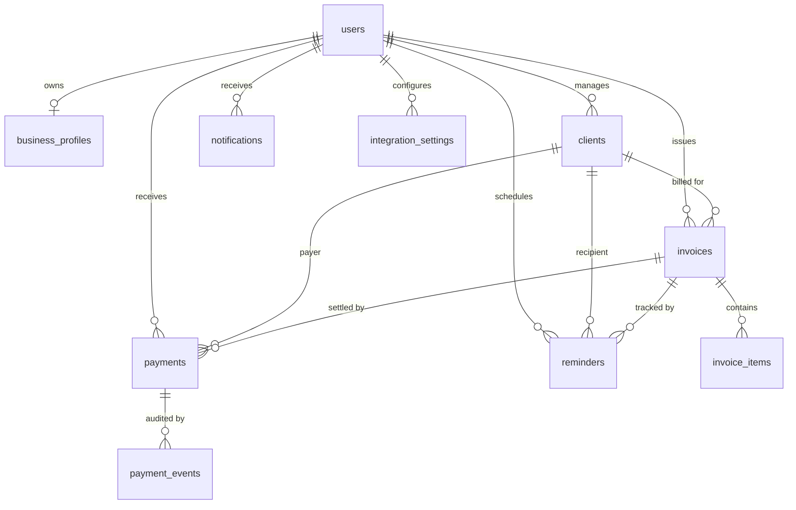

# PayPilot Database Schema Reference

The database models are built using SQLAlchemy 2.0 with strict foreign key constraints, indexes on high-traffic lookup columns, and decimal-safe numeric columns.

## Entity-Relationship Diagram

## Tables & Schema Specifications

### 1. `users`
- `id` (Integer, Primary Key)
- `email` (String 255, Unique, Indexed)
- `hashed_password` (String 255)
- `full_name` (String 255)
- `is_active` (Boolean, default True)
- `created_at` (DateTime UTC)
- `updated_at` (DateTime UTC)

### 2. `business_profiles`
- `id` (Integer, Primary Key)
- `user_id` (Integer, Foreign Key `users.id` ON DELETE CASCADE, Unique, Indexed)
- `business_name` (String 255)
- `business_type` (String 100)
- `owner_name` (String 255)
- `email` (String 255)
- `phone` (String 50, Nullable)
- `country` (String 100)
- `address` (Text, Nullable)
- `default_currency` (String 10, default 'USD')
- `time_zone` (String 100, default 'UTC')
- `created_at`, `updated_at` (DateTime UTC)

### 3. `clients`
- `id` (Integer, Primary Key)
- `user_id` (Integer, Foreign Key `users.id` ON DELETE CASCADE, Indexed)
- `name` (String 255, Indexed)
- `email` (String 255, Indexed)
- `phone` (String 50, Nullable)
- `company` (String 255, Nullable)
- `country` (String 100)
- `billing_address` (Text, Nullable)
- `preferred_currency` (String 10, default 'USD')
- `notes` (Text, Nullable)
- `is_archived` (Boolean, default False)
- `created_at`, `updated_at` (DateTime UTC)

### 4. `invoices`
- `id` (Integer, Primary Key)
- `user_id` (Integer, Foreign Key `users.id` ON DELETE CASCADE, Indexed)
- `client_id` (Integer, Foreign Key `clients.id`, Indexed)
- `invoice_number` (String 100, Indexed, e.g. `INV-2026-0001`)
- `issue_date` (String 50)
- `due_date` (String 50)
- `currency` (String 10)
- `subtotal` (Numeric 12,2)
- `tax_rate` (Numeric 5,2)
- `tax_amount` (Numeric 12,2)
- `discount_amount` (Numeric 12,2)
- `total_amount` (Numeric 12,2)
- `status` (String 50, Indexed: `DRAFT`, `APPROVED`, `SENT`, `PAID`, `OVERDUE`, `CANCELLED`)
- `notes`, `terms` (Text, Nullable)
- `paypal_order_id` (String 150, Nullable)
- `paid_at` (DateTime UTC, Nullable)
- `created_at`, `updated_at` (DateTime UTC)

### 5. `invoice_items`
- `id` (Integer, Primary Key)
- `invoice_id` (Integer, Foreign Key `invoices.id` ON DELETE CASCADE, Indexed)
- `description` (String 500)
- `quantity` (Numeric 10,2)
- `unit_price` (Numeric 12,2)
- `total` (Numeric 12,2)

### 6. `payments`
- `id` (Integer, Primary Key)
- `user_id` (Integer, Foreign Key `users.id` ON DELETE CASCADE, Indexed)
- `invoice_id` (Integer, Foreign Key `invoices.id`, Indexed)
- `client_id` (Integer, Foreign Key `clients.id`, Indexed)
- `transaction_id` (String 150, Unique, Indexed)
- `provider` (String 50, default 'PAYPAL')
- `amount` (Numeric 12,2)
- `currency` (String 10)
- `status` (String 50, default 'COMPLETED')
- `provider_reference` (String 255, Nullable)
- `payment_date` (String 50)
- `created_at` (DateTime UTC)

### 7. `payment_events`
- `id` (Integer, Primary Key)
- `payment_id` (Integer, Foreign Key `payments.id` ON DELETE CASCADE, Nullable)
- `event_type` (String 100)
- `payload` (Text, JSON)
- `signature_verified` (Boolean, default False)
- `created_at` (DateTime UTC)

### 8. `reminders`
- `id` (Integer, Primary Key)
- `user_id` (Integer, Foreign Key `users.id` ON DELETE CASCADE, Indexed)
- `invoice_id` (Integer, Foreign Key `invoices.id`, Indexed)
- `client_id` (Integer, Foreign Key `clients.id`, Indexed)
- `reminder_type` (String 50: `BEFORE_DUE`, `ON_DUE`, `AFTER_DUE`)
- `scheduled_date` (String 50)
- `sent_at` (DateTime UTC, Nullable)
- `status` (String 50: `SCHEDULED`, `SENT`, `FAILED`, `CANCELLED`)
- `error_message` (Text, Nullable)
- `channel` (String 50, default 'EMAIL')
- `created_at` (DateTime UTC)

### 9. `notifications`
- `id` (Integer, Primary Key)
- `user_id` (Integer, Foreign Key `users.id` ON DELETE CASCADE, Indexed)
- `title` (String 255)
- `message` (Text)
- `notification_type` (String 100)
- `is_read` (Boolean, default False)
- `link_url` (String 255, Nullable)
- `created_at` (DateTime UTC)

### 10. `exchange_rates`
- `id` (Integer, Primary Key)
- `base_currency` (String 10, Indexed)
- `target_currency` (String 10, Indexed)
- `rate` (Numeric 14,6)
- `fetched_at` (DateTime UTC, Indexed)

### 11. `audit_logs`
- `id` (Integer, Primary Key)
- `user_id` (Integer, Foreign Key `users.id` ON DELETE CASCADE, Indexed)
- `entity_type` (String 100)
- `entity_id` (String 100)
- `action` (String 100)
- `details` (Text, Nullable)
- `created_at` (DateTime UTC)

### 12. `integration_settings`
- `id` (Integer, Primary Key)
- `user_id` (Integer, Foreign Key `users.id` ON DELETE CASCADE, Indexed)
- `provider` (String 50: `PAYPAL`, `GEMINI`, `EMAIL`)
- `mode` (String 50: `sandbox`, `live`)
- `is_connected` (Boolean, default False)
- `config_data` (Text, JSON)
- `updated_at` (DateTime UTC)

